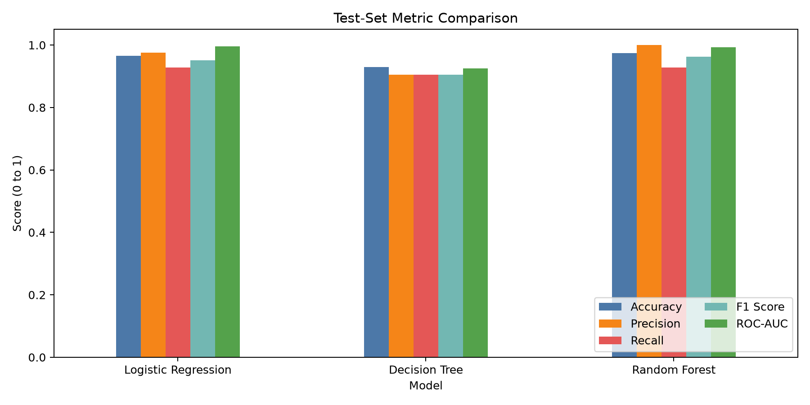
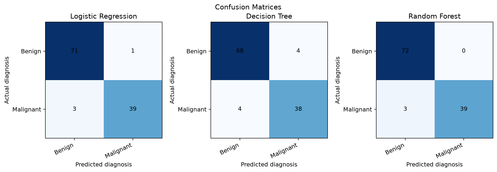
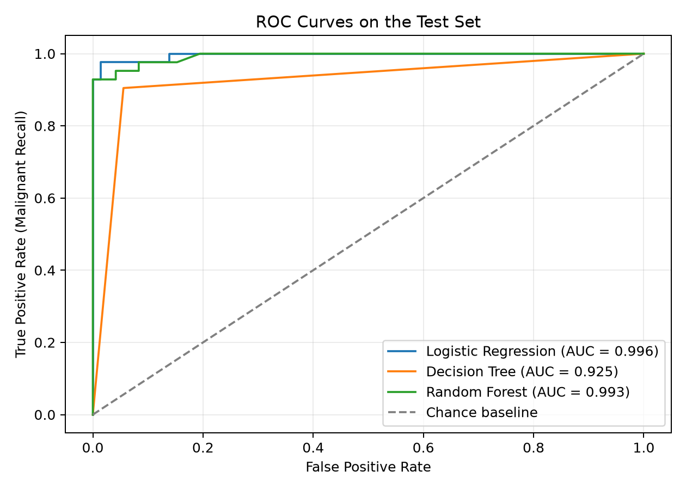
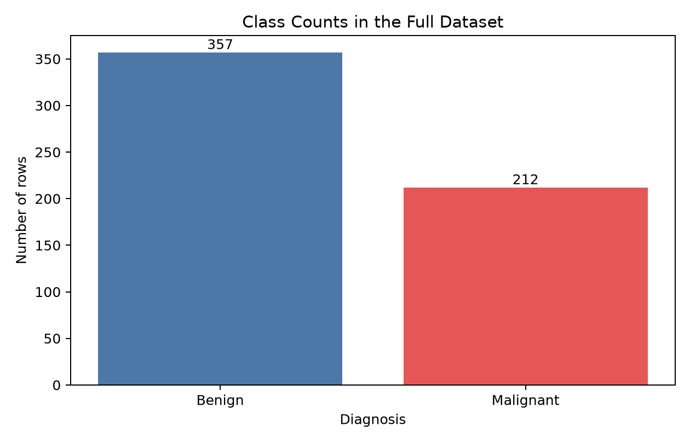

# Breast Cancer Classification using Machine Learning

MNR University — School of Engineering, Technology and AI  
Machine Learning Mini Project

## Team members

| Name | Roll number |
|---|---|
| Saicharan Karichella | 25RBAIM0085 |
<!-- Add all other team members and roll numbers here before submission. -->

## Project description
This educational project compares Logistic Regression, Decision Tree and Random Forest for classifying breast tumor measurements as benign or malignant. It is an academic experiment, not a clinical diagnostic tool.

## Dataset
Wisconsin Diagnostic Breast Cancer (WDBC), loaded through `sklearn.datasets.load_breast_cancer`. There are 569 samples, 30 numeric features, 357 benign and 212 malignant samples, and no missing feature values. A CSV copy is in `data/breast_cancer.csv`. The executable loads the same dataset from scikit-learn rather than reading the CSV.
- [Original dataset (UCI)](https://archive.ics.uci.edu/dataset/17/breast+cancer+wisconsin+diagnostic)
- [scikit-learn dataset documentation](https://scikit-learn.org/stable/modules/generated/sklearn.datasets.load_breast_cancer.html)

## Algorithms and methodology
- Logistic Regression: standardized features, maximum 5000 iterations.
- Decision Tree: unscaled features, default split settings.
- Random Forest: 100 trees, unscaled features.
- Stratified 80/20 train/test split: 455 training and 114 testing rows, seed 42. Malignant is the positive label (1). Scaling is fitted only on training data.

## Installation and execution
Use Python 3.11 or later in a compatible environment.

```bash
pip install -r requirements.txt
python breast_cancer_classification.py
```

Alternatively open `Breast_Cancer_Classification.ipynb` in Jupyter and run all cells. Install `notebook` separately if necessary (`pip install notebook`). Results are written to the local `results/` directory.

## Results
The following metrics were regenerated using the pinned dependencies listed in `requirements.txt`. Precision, recall and F1 refer to malignant tumors.

| Model | Accuracy | Precision | Recall | F1 | ROC-AUC |
|---|---:|---:|---:|---:|---:|
| Logistic Regression | 0.9649 | 0.9750 | 0.9286 | 0.9512 | 0.9960 |
| Decision Tree | 0.9298 | 0.9048 | 0.9048 | 0.9048 | 0.9246 |
| Random Forest | 0.9737 | 1.0000 | 0.9286 | 0.9630 | 0.9929 |









## Report and presentation
- [Project report](Project_Report.docx)
- [Presentation](Project_Presentation.pptx)

## Demo video
**Pending:** Add the actual public or unlisted video URL here before submission.

## Limitations
Single held-out split on a small benchmark dataset; external clinical validation was not performed. Accuracy alone is insufficient because missing malignant cases carries risk. No clinical deployment is claimed.
